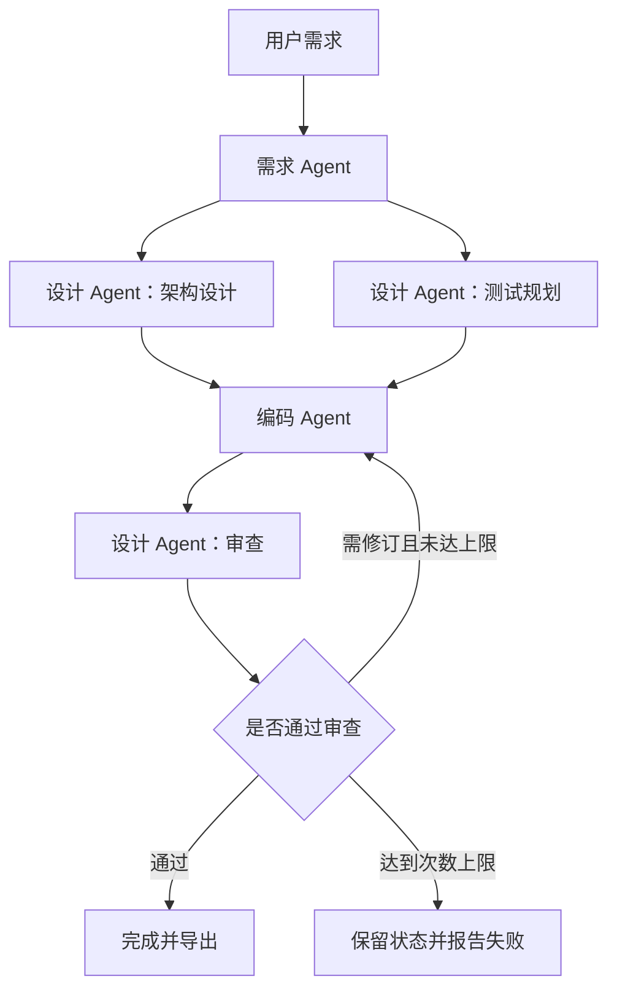

# Homework 2：Mini SE 多 Agent 工作流

需求、设计、编码三个Agent协作完成软件开发流程。支持千问和DeepSeek，提供顺序执行、并行规划、条件审查和有限次数的修订循环，以及可编辑的可视化编排界面。

## 快速运行

需要Node.js 22或更新版本，无需安装第三方npm依赖。

```bash
git clone https://github.com/elbbx/homework2.git
cd homework2/code
npm start
```

Windows也可以双击根目录的`启动.cmd`，服务就绪后自动打开浏览器。保持终端窗口开启，访问 **http://127.0.0.1:3000**。不要直接通过磁盘路径打开index.html执行工作流。macOS和Linux启动后手动打开网址。

## 模型配置

在网页选择服务商，填写对应API Key，模型名称可按账号权限修改。也可复制`code/.env.example`为`code/.env`并配置，启动脚本自动加载。

| 服务商 | 默认模型 | 默认接口地址 | Key环境变量 |
| --- | --- | --- | --- |
| 千问 | qwen-plus | https://dashscope.aliyuncs.com/compatible-mode/v1 | DASHSCOPE_API_KEY |
| DeepSeek | deepseek-chat | https://api.deepseek.com | DEEPSEEK_API_KEY |

`LLM_PROVIDER`指定默认服务商（qwen或deepseek）。支持QWEN_MODEL、QWEN_BASE_URL、DEEPSEEK_MODEL、DEEPSEEK_BASE_URL。自定义基础地址需使用HTTPS，不包含/chat/completions，千问工作空间域名按控制台配置。

两家Key独立读取，不跨服务商回退。切换服务商会清空网页临时Key。Key不会写入历史、编排配置、报告或仓库。

接口参考：[千问官方文档](https://www.alibabacloud.com/help/en/model-studio/model-calling-in-sub-workspace)、[DeepSeek官方文档](https://api-docs.deepseek.com/zh-cn/)。

## 流程和扩展



系统保留三个Agent角色。测试规划和代码审查复用设计Agent的不同职责节点。并行规划开启时，架构与测试规划通过Promise.all同时执行，编码节点等待两个分支汇合。审查结果是严格校验的JSON，决定完成还是重新编码。修订循环最多运行1至3轮，达到上限时明确失败，不会把未通过结果标成成功。

可在可视化编排区切换并行规划、审查、最大轮数，编辑三个角色的附加提示词，并保存、导入或导出编排配置。界面会据配置重绘节点和流程，执行器使用同一份配置。关闭并行和审查即可运行基础的三节点顺序流程。

## 使用步骤

1. 启动本地服务，选择需求模板或填写自己的需求。
2. 首次可勾选离线演示，它使用明确标记的固定待办示例，不调用模型。
3. 在编排区启用并行、审查和2轮修订，并打开离线“强制首次修订”，可观察并行、拒绝分支、回路及通过分支。该开关仅对离线模式有效。
4. 真实运行时关闭离线演示及强制修订，选择服务商并配置对应Key。默认高级流程比基础流程调用模型更多，修订也会增加用量。
5. 点击画布节点或产物标签查看各节点输出，在共享状态中检查消息、执行事件和修订记录。
6. 运行中可停止。失败、停止或服务重启后的中断记录可以从历史中恢复，已完成节点会跳过。恢复时需求、服务商、模型、模式和编排配置必须一致。
7. 导出JSON或Markdown报告，下载代码块，按产物中的文件名重命名后独立运行验收。工作流不会自动执行模型生成的业务代码。

## 状态与恢复

每个节点完成后写入`code/data/history.json`，保留最近30条运行记录。服务重启会将上次仍在运行的记录标记为中断，允许继续。已经完成的并行分支不必重新调用，新的修订轮次不会沿用上一轮审查批准。当前未完成节点会重新执行。

工作流记录节点状态、耗时、消息交接、事件时间、轮数及Token用量。请求限流、暂时故障或超时会重试，鉴权失败直接报告。审查格式错误会失败并保存状态。每次模型请求超时120秒。

## 验收与作业要求

完整对应表见[REQUIREMENTS.md](REQUIREMENTS.md)，架构说明见[DESIGN.md](DESIGN.md)。实现覆盖全部必做项及列出的推荐扩展。可选项目方向选择Mini SE流程，其余方向是替代选题。

```bash
cd code
npm test
```

22项测试覆盖基础流程、真正的并行重叠、条件分支、循环上限、失败恢复、逐节点落盘、重启恢复、两家服务商协议、密钥隔离及HTTP边界。`code/test-results/`包含历史真实调用结果和Python示例测试。

`npm run test:live`手动验证基础真实流程，`npm run test:live -- --advanced`验证高级流程，均会消耗API额度。高级结果单独保存到`advanced-live-result.json`，千问已真实完成并行规划及审查，使用5392 Tokens。DeepSeek没有提供真实Key，目前通过模拟接口验证协议。生成代码是否正确仍需独立验收。

## 文件结构

| 文件 | 用途 |
| --- | --- |
| index.html、code/app.js | 可视化编排、画布、产物、日志、历史与导出 |
| code/workflow.mjs | Agent职责、并行、条件分支、循环和模型调用 |
| code/workflow-config.mjs | 编排默认值与服务端配置校验 |
| code/server-app.mjs、code/server.mjs | 本机HTTP服务、检查点和启动入口 |
| code/providers.mjs | 千问/DeepSeek配置及密钥隔离 |
| code/*.test.mjs | 工作流、适配器与HTTP集成测试 |
| code/test-results/ | 真实调用记录、生成示例及验收材料 |

## 常见问题

- 地址栏是D:/…/index.html：改用http://127.0.0.1:3000。
- 更新后未出现新功能：关闭旧启动窗口，重新双击启动.cmd并刷新网页。
- 端口占用：关闭旧服务，或在code目录设置`$env:PORT='3001'`后执行`npm start`。
- PowerShell阻止脚本：使用启动.cmd或在code目录执行`npm start`。
- HTTP 401：检查当前服务商的Key、地域及权限。HTTP 429：检查限流和额度。
- 审查未通过且到达上限：查看审查意见，修改需求或提示词后新建运行。

网页需要Node.js后端，仅部署到GitHub Pages不能运行模型请求。提交或分享时不要包含.env、本地密钥笔记或运行历史。
