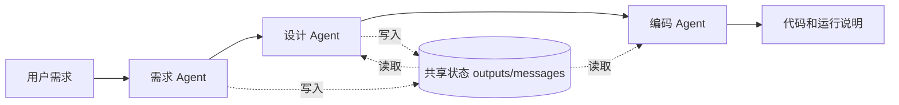

# Homework 2：Mini SE 多 Agent 工作流

## 项目说明

本实现选用模板中的“需求 → 设计 → 代码”，包含3个不同系统Prompt的Agent。真实模式调用所选服务商的API，演示模式使用明确标记的固定待办示例。

## 快速运行
安装Node.js 22或更新版本，无需npm install。

最方便的方式：双击根目录的 `启动.cmd`，保持终端窗口打开，然后访问 http://127.0.0.1:3000 。
首次从仓库下载后，可以勾选“离线演示”直接体验，无需API Key。真实调用需要所选服务商的Key，填写到网页，或将 `code/.env.example` 复制为 `code/.env` 并配置。页面显示“服务端已配置 API Key”时可以留空Key输入框。请勿将 `.env` 放入提交压缩包或上传仓库。

```powershell
cd homework2/code
.\start.ps1
```

若PowerShell阻止脚本执行，可直接运行 `node --env-file-if-exists=.env server.mjs`。
macOS / Linux 可在code目录运行 `npm start`，然后手动打开下面的地址。
浏览器打开 http://127.0.0.1:3000 。双击根目录index.html可静态预览，但实际调用需要本地服务。

从GitHub克隆：

```bash
git clone https://github.com/elbbx/homework2.git
cd homework2/code
npm start
```

无需安装第三方npm依赖。网页依赖本地Node.js后端，不能仅靠GitHub Pages运行。

## 作业要求对应

| 作业要求 | 本项目实现 | 证据位置 |
| --- | --- | --- |
| 至少2个Agent协作 | 需求、设计、编码3个角色，各自独立Prompt与调用 | code/workflow.mjs |
| 消息传递或状态共享 | outputs共享产物，messages记录发送者、接收者和正文 | 共享状态标签、live-result.json |
| 顺序执行完整流程 | 用户需求依次经过3个节点，最终产生代码 | 工作台节点、workflow.test.mjs |
| 可扩展性 | agents数组注册职责，统一调用接口 | DESIGN.md |
| 执行日志和状态 | 节点事件、耗时、Token、历史记录 | 工作台与测试记录 |
| 错误处理与恢复 | 重试、停止、保留已完成产物、恢复执行 | workflow.test.mjs |
| 文档 | 使用说明、架构图、设计说明、测试记录 | README.md、DESIGN.md、code/test-results/测试记录.md |

## 协作流程图



## 模型配置：千问与DeepSeek
网页中选择服务商后，模型名称自动切换。填入该服务商的API Key即可运行，两家密钥不能混用。

| 服务商 | 默认模型 | 默认接口地址 | 环境变量 |
| --- | --- | --- | --- |
| 千问 | qwen-plus | https://dashscope.aliyuncs.com/compatible-mode/v1 | DASHSCOPE_API_KEY |
| DeepSeek | deepseek-chat | https://api.deepseek.com | DEEPSEEK_API_KEY |

模型名称可按账号的可用模型修改。也可以复制code/.env.example为code/.env并分别配置两家的Key；LLM_PROVIDER指定默认服务商（qwen或deepseek）。支持QWEN_MODEL、QWEN_BASE_URL、DEEPSEEK_MODEL、DEEPSEEK_BASE_URL和PORT。自定义接口地址需使用HTTPS，填写基础地址，不包含/chat/completions。千问工作空间域名按控制台填写。

切换服务商会清空网页中临时输入的Key，避免混用。服务端只读取当前服务商对应的Key，不会把千问密钥发送到DeepSeek。历史记录保存服务商，恢复时必须使用相同服务商和模型。Key不会写入历史、报告或仓库。

接口参考：[千问官方文档](https://www.alibabacloud.com/help/en/model-studio/model-calling-in-sub-workspace)、[DeepSeek官方文档](https://api-docs.deepseek.com/zh-cn/)。

## 演示流程
1. 勾选离线演示，运行默认待办需求。
2. 观察三个Agent依次执行，切换需求、设计、代码查看各自产物。
3. 打开共享状态，查看outputs与messages中的交接关系。
4. 导出JSON用于报告截图或过程记录。
5. 取消离线演示并填入Key进行真实调用。每次完整运行产生3次模型请求，限流或临时错误可能重试。

## 验收
在code目录执行 `npm test`，验证顺序、消息传递、失败状态和恢复跳过已完成节点。生成的业务代码不自动执行，请复制到独立文件后验证其行为。

## 文件说明
- index.html：根目录可视化工作台，响应式布局、节点状态、日志、产物查看和导出。
- code/server.mjs：本机HTTP服务、千问配置、流式事件输出与恢复入口。
- code/workflow.mjs：Agent注册、共享状态、消息交接、API调用与重试。
- code/workflow.test.mjs：工作流行为测试。
- DESIGN.md：架构和扩展说明。

## 新增功能
- 需求模板：待办清单、成绩统计和记账工具，也可以自由输入。
- 停止执行：中断正在进行的模型请求，保留已完成节点。
- 恢复执行：失败或停止后从未完成节点继续，避免重复运行上游。恢复时需求、模型和模式必须相同。
- 本地历史：保存最近30条运行结果到code/data/history.json，重启后可载入并恢复已保存的失败或停止记录。进程被强制终止时正在运行的任务不保证保存。
- 执行统计：显示完成节点耗时和模型返回的Token用量，不估算人民币费用。
- 多种导出：完整JSON、Markdown实验报告、编码产物复制以及代码块下载。代码块按generated-N命名，请按报告说明改名后运行。
- 输入校验、同一服务单流程并发限制与跨站请求拒绝。

## 推荐使用步骤
1. 启动服务并打开网页，确认已配置Key。
2. 先勾选离线演示体验界面。该模式使用固定待办代码，不根据输入真实生成。
3. 取消离线演示，选择成绩统计等模板，或输入自己的具体需求，点击运行。
4. 观察需求、设计、编码三个节点依次完成。运行期间可以查看产物和共享状态，也可以点击停止。
5. 完成后导出报告和代码块，依据编码产物中的文件名重命名代码，并独立执行验收。
6. 后续通过运行历史重新查看结果。失败或停止记录可以继续恢复。

遇到端口占用时先关闭旧服务窗口。需要换端口时，在code目录运行 `$env:PORT='3001'`，然后 `npm start`，访问 http://127.0.0.1:3001 。

## 测试记录
2026-10-22，qwen-plus真实三Agent调用成功，总耗时42.528秒，共3810 Tokens。原始结果保存在code/test-results/live-result.json，不含Key。人工检查并提取生成的summarize.py和test_summarize.py后，独立运行6个Python unittest测试全部通过。模型文本中提到“9个测试”，实际执行数为6，以本地实测为准。

`npm test`：9个测试通过，覆盖交接顺序、失败恢复、停止恢复、空输出、服务商配置、密钥隔离、两家请求协议及鉴权失败。HTTP集成检查覆盖页面资源、历史保存、空输入400、并发409、跨站403和停止恢复。两家服务商的离线流程与配置接口已通过集成检查。千问统一接口已真实验证成功；DeepSeek未配置真实密钥，当前通过模拟接口验证协议，不代表已完成真实DeepSeek调用。

在code目录执行 `npm run test:live` 可重新发起3次所选服务商的真实请求，并更新test-results/live-result.json，会消耗API额度。

建议提交源码、README、DESIGN和一次真实运行的结果及截图；录屏可演示输入、运行、交接和产物。此为准备建议，模板尚未公布最终提交物。

